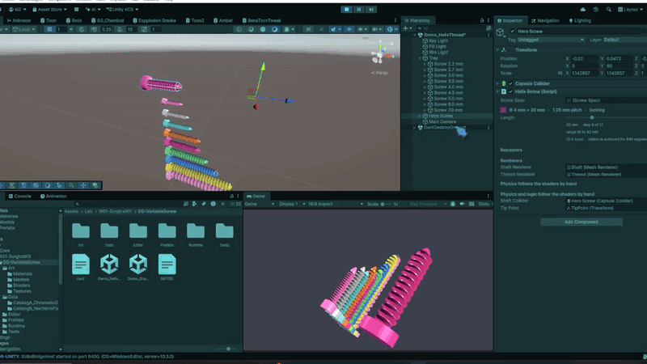

<!-- Generated from card.json by site/build.mjs. Edit card.json instead. -->
# XR Systems Lab

Small systems that plug into larger XR and game projects.

[Portfolio page](https://m-zidan73.github.io/xr-systems-lab/) · [LinkedIn](https://www.linkedin.com/in/mzidan73) · [Behance](https://www.behance.net/m_zidan)

## Week 1: Surgical-training kit

| | System | What it does | Tested on |
|---|---|---|---|
|  | [Variable Screw](unity/Assets/Lab/W01-SurgicalKit/D0-VariableScrew) | One screw mesh that changes length through data and snaps only to sizes the catalog ships. | PC |

## Open it in Unity

1. Install [Git LFS](https://git-lfs.com) before you clone, because the models are stored with it.
2. In Unity Hub, add the `unity` folder and open it with Unity `6000.4.9f1`.
3. Open a `Demo` scene from a system's folder and press Play. Right-drag orbits, middle-drag or Shift + right-drag pans, and scroll zooms.
