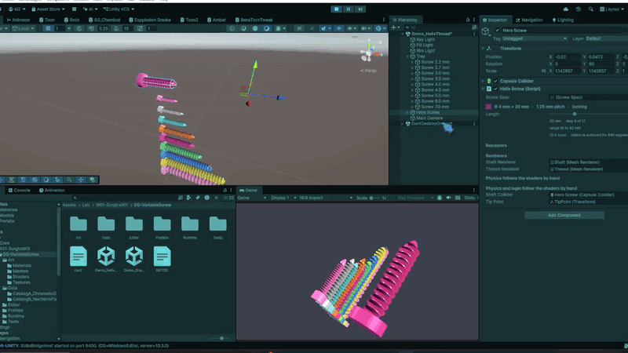

<!-- Generated from card.json by site/build.mjs. Edit card.json instead. -->
# Variable Screw

One screw mesh that changes length through data and snaps only to sizes the catalog ships.

Tested on: PC

> Sizes, colours and catalogs are illustrative example data, not clinical guidance.

## How it works

Currently, it's just a demo of how a single mesh can be repurposed for different lengths of screws by simply sliding through variable lengths. The primary goal is to recycle a single mesh and texture for better performance in medical applications.

## My decisions

- **Decision:** One of the decisions was to create a shader version of the screw. **Alternative:** While the Helix version looked more realistic from different viewing angles, it cost more performance. **Why:** On the other hand, the shader is just faking the spirals, so it can be used on lighter devices.

## Next steps

Currently, the goal is not to develop an entire medical VR application, but we aim to create small projects like these that eventually can be assembled to create a full-fledged VR application when requested.

## Asset credits

- **Screw and thread meshes:** Modelled in Blender with Claude Code + Blender MCP. Licence: Made for this project.

---

Built with Claude Code + MCP for Unity + Blender MCP. Design decisions and explanation: Mohitur Rahman Zidan.
