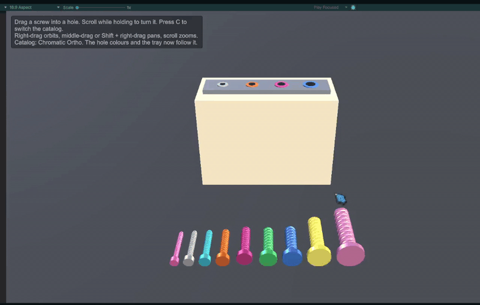

<!-- Generated from card.json by site/build.mjs. Edit card.json instead. -->
# Colour-Coded Holes

Plate holes take their colour from the implant catalog and only accept a screw of the matching size.

Tested on: PC

> Sizes, colours and catalogs are illustrative example data, not clinical guidance.

## How it works

One screw is selected with the mouse and dragged and dropped onto the same color as the screw hole, and this checks as a success. The diameter of the screw has to match the diameter of the hole. Only then will the hole accept the screw. Otherwise, it would return back to its origin. We can also zoom in and out, pan, and orbit around the screws.

## My decisions

- **Decision:** The screw is dropped into the hole when the cursor is nearest to a hole. It does not matter where the tip of the screw is. **Alternative:** One alternative is to use physics collision. The idea is that when the screw collider hits the collider of the hole in the tray, it checks ok, then it attaches itself to the hole. **Why:** This is only applicable for the PC version because, in the flat screen, it's hard to assume the correct 3D position in space.

## Next steps

Instead of the tray, we will use actual bone and plates to screw in, and that's where the real test starts. Users have to accurately determine which screw size to use in the hole.

## Asset credits

- **Screw meshes:** From the Variable Screw system, modelled in Blender with Claude Code + Blender MCP. Licence: Made for this project.

---

Built with Claude Code + Unity CLI. Design decisions and explanation: Mohitur Rahman Zidan.
